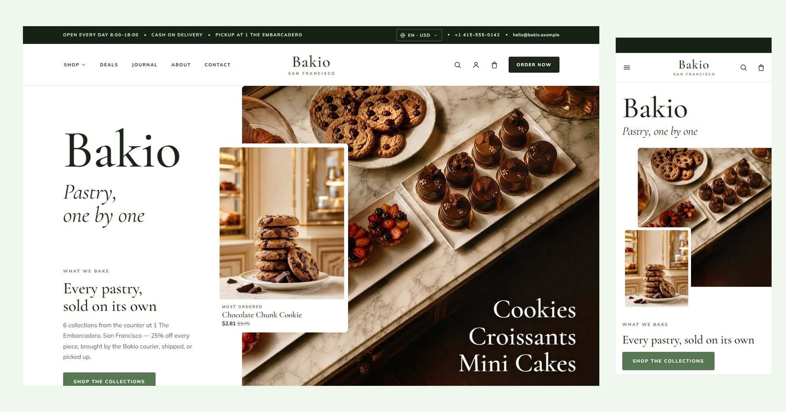
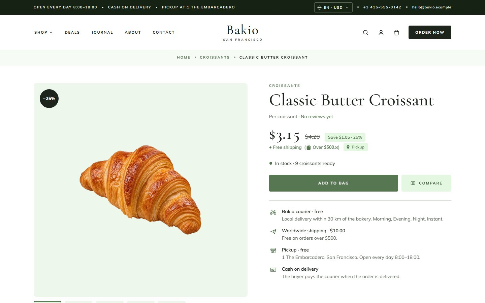
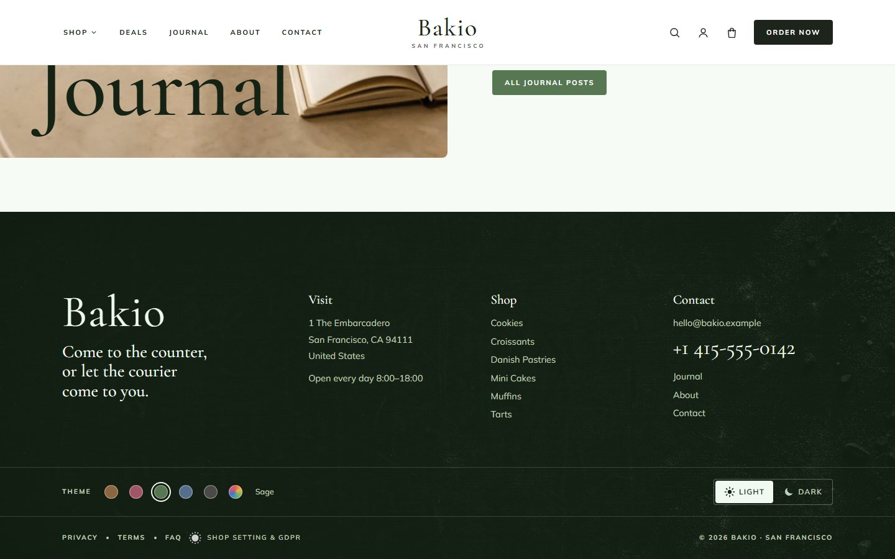
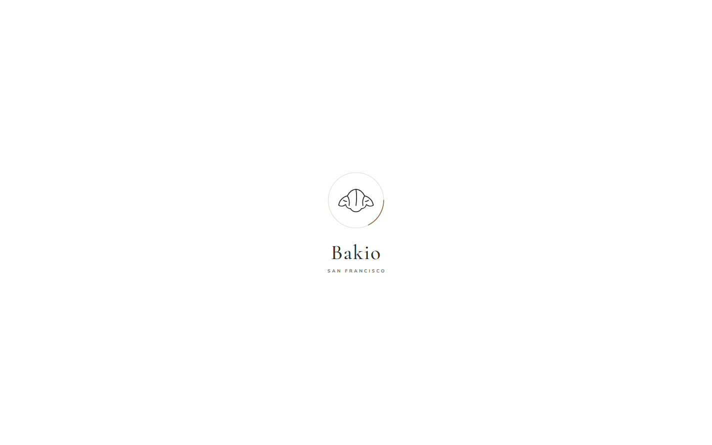

<p align="center">
  
</p>

<h1 align="center">Pralino Classic Patisserie</h1>

<p align="center">
  <b>A classic, editorial pâtisserie: white and soft-tint bands, near-black ink, one tan accent, Cormorant Garamond over Mulish and big photography.</b><br>
  A custom Selldone Layout built on the official <a href="https://github.com/selldone/storefront">selldone/storefront</a>.
</p>

<p align="center">
  <a href="https://pralino.selldone.shop"></a>
  <a href="https://github.com/selldone-custom-layouts/official-pralino/wiki"></a>
  <a href="https://github.com/selldone-custom-layouts/official-pralino/wiki/Install-with-AI"></a>
  
  
  
</p>

<p align="center">
  <a href="https://pralino.selldone.shop"><b>Open the live shop</b></a> ·
  <a href="https://github.com/selldone-custom-layouts/official-pralino/wiki/Install-with-AI">Set it up with AI</a> ·
  <a href="https://github.com/selldone-custom-layouts/official-pralino/wiki/Manual-Setup">Manual setup</a> ·
  <a href="https://github.com/selldone-custom-layouts/official-pralino/wiki/Shop-Requirements">What your shop needs</a> ·
  <a href="https://github.com/selldone-custom-layouts">All Selldone custom layouts</a>
</p>

---

## What it is

**Pralino Classic Patisserie** dresses a single pâtisserie as a classic, editorial bakery website: a dark top bar with the counter's hours and contact, a white header with the shop's name as a centred serif wordmark (the city under it), a hero where the counter photo runs to the window's edge with a framed photo across the seam and the most-ordered collections on its dark corner, the shop in numbers and its story, the best-selling collections as photo rows, how ordering works, an offer card beside the ways to receive an order, a gallery of the collections, today's selection as numbered rows, a full-width photo band, a marquee of the collections and the journal. It was drawn for **Bakio**, a bakery that sells individual pastries for courier delivery, worldwide shipping and pickup, paid in cash on delivery.

- **one colour family**: the palette's hue gives every ground — the white page, its soft tint bands, the plates under the pastries, the lines, the words, the dark top bar and footer — and the one action colour (Tan `#8B6640` by default), so a palette or a custom colour re-tints the whole page;
- Cormorant Garamond for headings, the wordmark and numbers set large, over Mulish for reading, buttons and the nav (in spaced capitals);
- **one shape language**: circles for round things (the −% roundel, icon buttons, the mark), 8 px panels and photos, 4 px inner parts (buttons, chips, fields, plates); square only where a band meets the window's edge;
- big photography in every section (the shop's own photos, with drawn or cut-out fallbacks), faint line drawings of pastries in the title bands;
- flat buttons, hover changes the colour only, no line under any word or icon, selection rings inside the box;
- light by default, with a dark mode in the same family; a **Theme** row in the footer on the showcase shop: five palettes (Sage by default, Tan, Rose, Slate, Ink), a **Custom colour** and Light / Dark;
- it says **bag**, never cart; every word it writes is in English and Arabic (right to left).

It runs on **[pralino.selldone.shop](https://pralino.selldone.shop)**, one domain of the Selldone shop Bakio (Selldone lets each domain of a shop carry its own Layout; the shop's default and its other domains keep theirs).

Everything is read live from the shop: its title (drawn as the wordmark), collections, products, prices and savings, sales (for the hero, the collection cards and today's selection), delivery ways with their days, fees and time windows, the pickup counter and its hours, the way to pay, the articles. Nothing about Bakio is written in the code, so another bakery that imports the Layout gets its own data. Selldone's own bag, checkout, payments and orders keep working underneath.

## Screenshots

| Desktop | Phone |
| --- | --- |
|  |  |
|  |  |
|  |  |
|  |  |

| Dark mode (desktop) | Dark mode (phone) | The Theme row (footer) |
| --- | --- | --- |
|  |  |  |

## Highlights

- **Header:** a dark top bar in the family's darkest shade (the counter's days and hours, the way to pay and "Pickup at <street>" on the left; the language and currency pill, the phone and the email on the right); a white bar that sticks, with **Shop ⌄** (every collection with its best seller's photo and its lowest price, the most-ordered collection's photo, then the deals line), Deals, Journal, About and Contact on the left, the wordmark in the centre, search with live suggestions, the account, the bag with its count and **Order now** on the right. Every layer opens on a click and closes on a second one, Esc or a click outside. On a phone: the menu button, the wordmark, search and the bag; the menu is a panel from the left with the collections, the pages, the account, a "Language & currency" row and the counter's lines.
- **Home:** the hero (the shop's name and "Pastry, one by one", what it bakes and **Shop the collections**; the counter photo to the window's edge with a framed inset of the most-ordered collection across the seam, and the three most-ordered collections set large on the photo's dark corner); **<shop> in numbers** (collections, the saving, the counter's days and hours, the ways to receive an order) beside its story, from the shop's own facts, with Delivery, Pickup and Payment links; **The four collections people order most** as photo rows (an outlined numeral, the description, three best sellers with prices, "Shop <collection>"); **How ordering works** over a photo (piece by piece, the courier's windows, the way to pay, pickup) with the courier's card; the courier's numbers, the offer card on its photo and **<n> ways to receive it**; a gallery of the collections around the most-ordered one; **Today's selection** (six best sellers mixed across collections, as numbered rows with **Add to bag**); a full-width photo band; a marquee of the collections; the journal's newest posts beside its photo last.
- **Photos:** every photo slot (the hero's two, About, How ordering works, the offer card, the photo band, the journal, the footer's texture, each collection's photo) shows the shop's own photo when the Layout has one, else a designed fallback: the family tint with one of the mockup's pastry drawings, or the shop's own pastries as cut-outs. Never a caption or a file name.
- **Collection page:** the title band with the collection's photo, its name, its line and the saving; every collection as a chip; the filter panel beside the grid; a bar with the active filters as chips and **Sort**; the grid of cards; then a strip of three panels (the courier, the collection's photo, pickup at the counter). Search, Deals and every pastry share the grid: search adds the collections it found as tabs and posts from the journal; Deals opens with the biggest saving today.
- **Filters:** the price (two thumbs and short boxes), On offer, then every spec group of the collection's own products (a paragraph-long note is never a filter; long values four at a time with "Show N more"); a side sheet below 1200px; a change dims the cards with "Updating results…", then the new ones fade up.
- **Card:** the pastry as a cut-out on its tinted plate with a round −% and a quick-view eye in the plate's corners, the collection, the name, "Per <unit>" (and "only n left"), the price with the struck was-price and the saving, then **Add to bag**, which turns into "− n +" in place.
- **Product page:** the slim title band with the breadcrumb; the gallery (the pastry on its plate, thumbnails) beside a buy column that stays in view: the collection, the name, "Per <unit> · No reviews yet", the price, the saving, a deal clock only for a real end date, the stock, options only when the product really has variants, **Add to bag** beside Compare, and the delivery, pickup and payment lines. Then the tabs (Description with "Why you'll love it", Additional information, Reviews), **Buy together** (this pastry and two best sellers from other collections, "Add all three to bag"), **More <collection>**; a buy bar on a phone once the Add box has scrolled away.
- **Bag and checkout, orders and account, pages:** the bag drawer with "Often added", the bag page with "How it reaches you", the checkout (step pills in the title band, numbered cards for contact, delivery and its windows, the address or the pickup counter, billing and a note, the receipt with "Place order"), the delivery sheet, the address sheet (map on or off), Selldone's payment window, the order page with its progress, receipt and chat, the account (Overview, Orders, Addresses, Profile), the sign-in sheet, compare, the journal and its posts, About, Terms, Privacy, FAQ, Contact and a 404 inside the Layout, all in the same family and shapes.
- **Footer:** the family's dark band over a linen texture: the shop's name set large with one line on how orders reach the buyer; Visit (the counter's address, days and hours); Shop (the collections); Contact (the email, the phone set large, the Journal, About and Contact pages); the Theme row; a legal row with Privacy, Terms, FAQ, Selldone's cookie settings, the shop's social links and the copyright.

## Tests

Every check runs one browser at a time against the shop, at 1440px, 1024px and 390px, dark and light, every palette and the custom colours #ffff00, #00ffff and #111111, and Arabic (right to left). Each is delivered at **TOTAL 0**.

<!-- TESTS:START -->
Version **1.0.0**, 15 November 2026, on the dev server against the live shop data (`CIRCLE_CURRENCIES=USD,AED,DKK,SAR bash scripts/run-checks.sh http://localhost:9150 <logs>`): 49 checks.

| Check | What it looks for | Where | TOTAL |
| --- | --- | --- | --- |
| Ring sweep (dark, light, Arabic) | every selection ring and edge drawn inside its box | 18 pages (home, collection, deals, search, two products, compare, journal, post, About, Terms, Privacy, Contact, FAQ, 404, bag, checkout, account), 9 in Arabic | **0** |
| Card edge (kit; Pralino's cards: dark, light, Arabic) | no card's content touching its edge | home, collection, search, deals, journal, About, Terms, Privacy, FAQ, Contact, account, compare; 1440, 1024, 390 | **0** |
| Corner clear (and Arabic) | the quick-view eye on a card never on or touching words | 9 pages, 390, 768, 900, 1024, 1280, 1366, 1440, 1920 | **0** |
| Circle fit (light, dark, Arabic; USD, AED, DKK, SAR; long prices) | the words in any circle stay inside it, also with a made-up "XXXX 1,234,567" in every circle | home, deals, a collection, two products | **0** |
| Contrast: Tan dark and light; Rose, Sage, Slate, Ink and the custom #ffff00, #00ffff, #111111 in both modes; Arabic light and dark | every word at 4.5:1 or better on what is really behind it | 18 pages for Tan, 9 for each other theme; 1440, 1024, 390 | **0** |
| Contrast with layers open | the bag drawer or the phone menu open; the sign-in sheet open | home | **0** |
| Bag audit (dark, light) | the drawer, the bag page and the address sheet | 1440 and 390 | **0** |
| Currency | every price, filter and total follows the picked currency at once | home, collection, product, deals, drawer, menus | **0** |
| Box check (dark, light, Arabic) | no photo over words, icon rows aligned | 16 pages and the open layers | **0** |
| Arabic words | every word the Layout writes is Arabic after the switch | home, footer, collection, product, bag, sign-in, FAQ, 404, About, Contact, journal, Terms, Privacy, account, compare | **0** |
| Shape audit (light, dark, custom teal, Arabic) | every edge a circle, 8 px or 4 px (square only at the window's edge), focus keeps its shape, one inset ring per field, nothing past the window; with every layer open | 16 pages | **0** |
| Underline (dark, light) | no line under any word or icon, at rest or on hover | 14 pages | **0** |
| Production bundle | the built release loads through the shop's own HTML and draws home, a collection, a product, the journal, a post, the bag and the checkout with no page error | 1440 | **OK** |

Bakio sells in USD only, so AED, DKK and SAR stay USD on its pages; the long made-up amount stands in for them. Bakio sells in English only; the Arabic runs use the dev server's test switch (`scripts/pw-shop-languages.cjs` on a live shop).

**1.0.1** (one 1920 px page frame, nothing sized from the window, the in-app splash, no half-made facts on first paint) added wide windows to the layout checks and a new probe, `scripts/text-column-check.cjs` (no running text in a sliver, no word broken mid-word, no squeezed track, no words over words): card edge, corner clear, box and text columns at 1440, 1920, 2560, 2880 and 3840 (and 390) **0**; the shape audit up to 3840 **0**; the splash's checks (`scripts/splash-check.mjs`: long and Arabic names, contrast in every palette and custom colour, hand-over from the domain's loading frame, gone by 4 s, never twice in a session) **0**; the guest checkout walk (`scripts/pralino-checkout-walk.mjs`, every way to Selldone's payment window, nothing ordered) **OK**. On the live shop with 1.0.1: contrast in every palette and custom colour, the bag, currency, box, Arabic words, text columns, shapes, underline and corner-clear, 39 checks at **0**, and the walk **OK** on desktop and phone.
<!-- TESTS:END -->

## Languages

Every word Pralino writes goes through `t("key", "English")` ([`components/kalio/i18n/`](components/kalio/i18n/)): the shared words in `base/<lang>.ts`, the Layout's own in `pralino.<lang>.ts` (keys `pralino.*`), and the `bakini.*` words the shared code still uses in `bakini.<lang>.ts`. Arabic loads only when a visitor picks it and turns the whole page right to left. The wiki page [Customize](https://github.com/selldone-custom-layouts/official-pralino/wiki/Customize) has the steps for another language.

## Theme and colours

Pralino runs the shared theme switcher (`components/theme-switcher/`, the same code as the other custom Layouts). On your own shop the visitor switcher is hidden, and Pralino shows the theme you set in **one file**, [`components/pralino/pralino-theme.settings.ts`](components/pralino/pralino-theme.settings.ts): a palette (`tan`, `rose`, `sage`, `slate`, `ink`) or any brand colour (`brandColor: "#F5C400"`; a light colour keeps dark words on it with `textOnBrand: "auto"`), `light` or `dark`, and whether your visitors get the switcher (`themeSwitcher: "showcase" | "on" | "off"`). The whole page takes the colour's family (grounds, plates, lines, words, the dark bars), drawn by [`components/pralino/pralino-family.ts`](components/pralino/pralino-family.ts); every colour is made readable automatically. An AI agent finds the steps in the "Theme" section of [`AGENTS.md`](AGENTS.md).

## Loading screen



Pralino has its own loading screen in the same look: a white ground, a fine tan ring that turns, the croissant line art drawing itself, and your brand (a logo of any shape, or the name and sub line as the header draws them); only the ring and the line art move, it is still for reduced motion and fades when the shop is ready. Set your brand in a copy of `scripts/loading/configs/pralino.json`, run `node scripts/loading/make-loading.cjs <your config> <out folder>` (it writes `loading.json` and `loading-preview.html`; `scripts/loading/test-loading.cjs` proves long, Arabic, wide-logo and tall-logo brands still fit), then paste its head and body into the domain's **custom loading** in Selldone (mode custom; head ≤ 15,360 bytes, body ≤ 3,072 bytes, no data URIs). Steps: [Go Live](https://github.com/selldone-custom-layouts/official-pralino/wiki/Go-Live#5-your-own-loading-screen).

## Use it on your shop

| You want to… | Read |
| --- | --- |
| Let an AI agent (Claude Code, Codex…) set it up for your shop | [Install with AI](https://github.com/selldone-custom-layouts/official-pralino/wiki/Install-with-AI) |
| Do it yourself, step by step | [Manual Setup](https://github.com/selldone-custom-layouts/official-pralino/wiki/Manual-Setup) |
| Know what data your shop needs for the design to look right | [Shop Requirements](https://github.com/selldone-custom-layouts/official-pralino/wiki/Shop-Requirements) |
| Build, upload and verify a release | [Build and Upload](https://github.com/selldone-custom-layouts/official-pralino/wiki/Build-and-Upload) |
| Put the Layout live on your shop, or on one domain of it | [Go Live](https://github.com/selldone-custom-layouts/official-pralino/wiki/Go-Live) |
| Change the name, sections, pages, photos or languages | [Customize](https://github.com/selldone-custom-layouts/official-pralino/wiki/Customize) |
| Change the colours, dark or light, the visitor switcher | [Theme and colours](https://github.com/selldone-custom-layouts/official-pralino/wiki/Theme-and-colours) |
| Fix a blank page, a rejected upload or an old version showing | [Troubleshooting](https://github.com/selldone-custom-layouts/official-pralino/wiki/Troubleshooting) |


## Quick start (developers)

```bash
git clone https://github.com/selldone-custom-layouts/official-pralino.git
cd official-pralino
npm run setup            # the six Selldone modules (modules/)
for p in components translate; do git -C modules/$p apply ../../patches/modules-$p.kalio.patch; done
npm install --force
npm run serve            # dev server on http://localhost:9150, reading the shop named in .env
```

`.env` names the shop the dev server reads (`VITE_APP_SAMPLE_SHOP_NAME=bakio`). Releases:

```bash
LAYOUT_ID=<your Layout id> SELLDONE_CLI_SRC=<cli clone> bash scripts/release.sh <new version> desk
```

Leave `LAYOUT_ID` out on the first upload; use the id printed after it from then on. Never reuse a version number. Keep the build at 300 files or fewer (the release script prints the count).

## Where things are

| Area | Files |
| --- | --- |
| Your theme (palette, brand colour, mode, switcher) | [`components/pralino/pralino-theme.settings.ts`](components/pralino/pralino-theme.settings.ts) |
| Pralino's tokens for both modes (`:root` light, `html.pr-dark` dark), the type and the shape scale; the colour family from the palette | [`style/pralino-theme.scss`](style/pralino-theme.scss), [`components/pralino/pralino-family.ts`](components/pralino/pralino-family.ts) |
| The mockup's stylesheets, scoped to `.pr` (generated by [`scripts/pralino-css.cjs`](scripts/pralino-css.cjs), never edited) | [`style/pralino/`](style/pralino/) |
| The Layout's own touches; Selldone's address sheet and payment window in Pralino's dress | [`style/pralino-layout.scss`](style/pralino-layout.scss), [`style/pralino-sd.scss`](style/pralino-sd.scss) |
| Header, bag drawer and footer | [`components/pralino/shell/`](components/pralino/shell/) (`PralinoHeader.vue`, `PralinoBagDrawer.vue`, `PralinoFooter.vue`) |
| Home | [`components/pralino/PralinoHome.vue`](components/pralino/PralinoHome.vue) |
| The wordmark, from the shop's title | [`components/pralino/PralinoLogo.vue`](components/pralino/PralinoLogo.vue) |
| Shared data and layers (the collections, the catalogue, the shop's facts, one layer at a time) | [`components/pralino/pr.ts`](components/pralino/pr.ts) |
| Shared UI (title band, card, quick view, modal, empty state, sample label, numerals, icon lines, the shop's mark) | [`components/pralino/ui/`](components/pralino/ui/) |
| Photo slots and their fallbacks | [`components/pralino/pr-photos.ts`](components/pralino/pr-photos.ts), `PrPhoto.vue`, `PrCuts.vue` |
| The shop's photos (optional; the slots fall back to drawings and cut-outs) | `assets/pralino/pralino-<slot>.webp` and `assets/pralino/pralino-col-<collection title as a slug>.webp`, names in `pr-photos.ts` |
| Collections, search, deals, every pastry (filters and sort) | [`components/pralino/shop/PrListing.vue`](components/pralino/shop/PrListing.vue), [`pages/products/`](pages/products/) |
| Product page and compare | [`components/pralino/product/`](components/pralino/product/), [`pages/product/`](pages/product/), [`components/pralino/compare/`](components/pralino/compare/) |
| Bag and checkout, the delivery sheet | [`pages/basket/cart/`](pages/basket/cart/) with [`components/pralino/buy/pr-cart.ts`](components/pralino/buy/pr-cart.ts); the delivery sheet in [`pages/basket/cart/SCartShippingOptions.vue`](pages/basket/cart/SCartShippingOptions.vue) |
| Order page | [`components/pralino/order/`](components/pralino/order/), [`pages/basket/order/`](pages/basket/order/) |
| Account and sign-in | [`components/kalio/account/`](components/kalio/account/), [`pages/user/`](pages/user/), [`components/kalio/shell/KalioSignIn.vue`](components/kalio/shell/KalioSignIn.vue) |
| Journal, article, About, Terms, Privacy, FAQ, Contact, 404 | [`components/pralino/read/`](components/pralino/read/), [`pages/blog/`](pages/blog/), [`pages/official/`](pages/official/), [`pages/faq/`](pages/faq/), [`pages/errors/404/`](pages/errors/404/) |
| Words (English and Arabic) | [`components/kalio/i18n/pralino.en.ts`](components/kalio/i18n/pralino.en.ts), [`pralino.ar.ts`](components/kalio/i18n/pralino.ar.ts) (`pralino.*`; `bakini.*` for the shared code) |
| How the mockup became the Layout, reversible choices, data rules and releases | [`PRALINO.md`](PRALINO.md) |
| The checks | [`scripts/run-checks.sh`](scripts/run-checks.sh) and the tools it names (`CIRCLE_CURRENCIES` for the circle checks) |
| Release tooling; the loading screen (`scripts/loading/`) | [`scripts/`](scripts/) |
| Selldone storefront's original README | [`README.selldone.md`](README.selldone.md) |

Pralino started from Domino (itself from [Bakini Noir](https://github.com/selldone-custom-layouts/official-bakini)) and keeps the buy flow underneath (the Kalio base: Selldone's bag, checkout, address sheet, payment window, order, account, sign-in and compare logic; the theme and region switchers; the release scripts and the checks); every page's markup is Pralino's own.

## Credits and license

Built on the official [Selldone Storefront](https://github.com/selldone/storefront) (MIT License, © Selldone); see [`LICENSE.md`](LICENSE.md). Photos generated with Magnific (Freepik) for Bakio under the owner's Premium plan. Part of **[Selldone Custom Layouts](https://github.com/selldone-custom-layouts)**.
