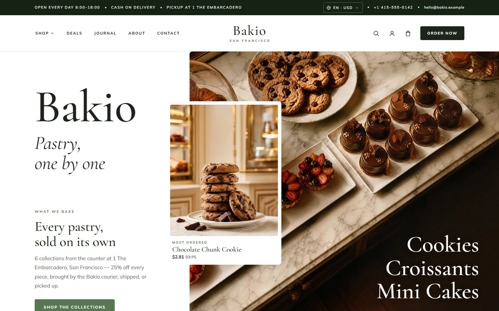
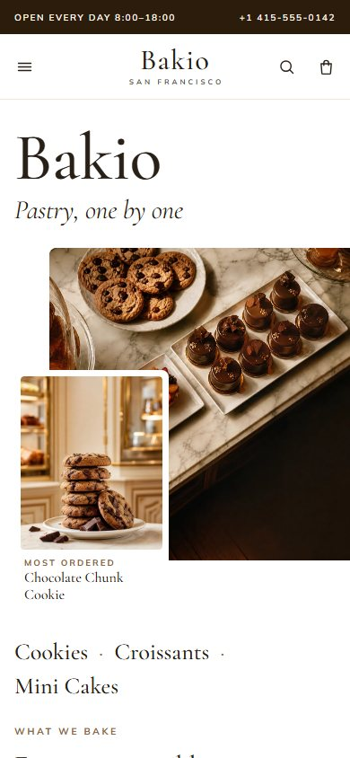
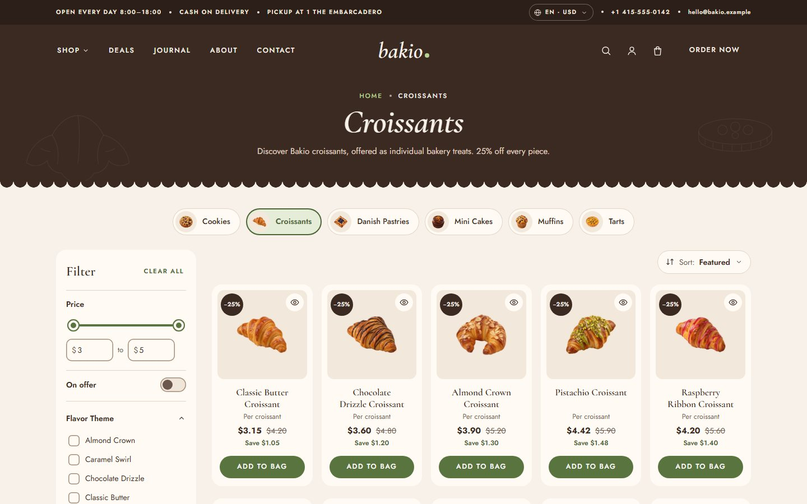
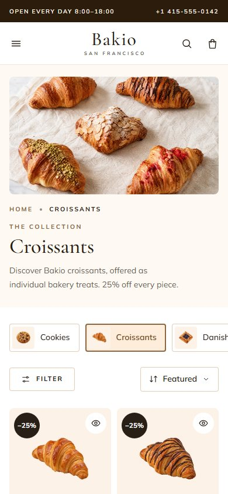
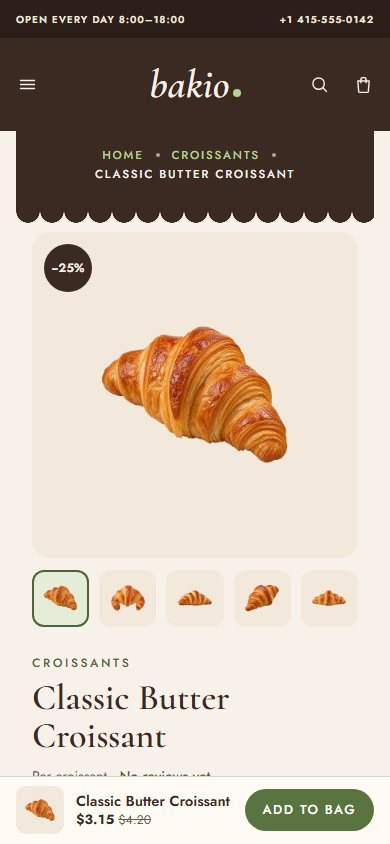
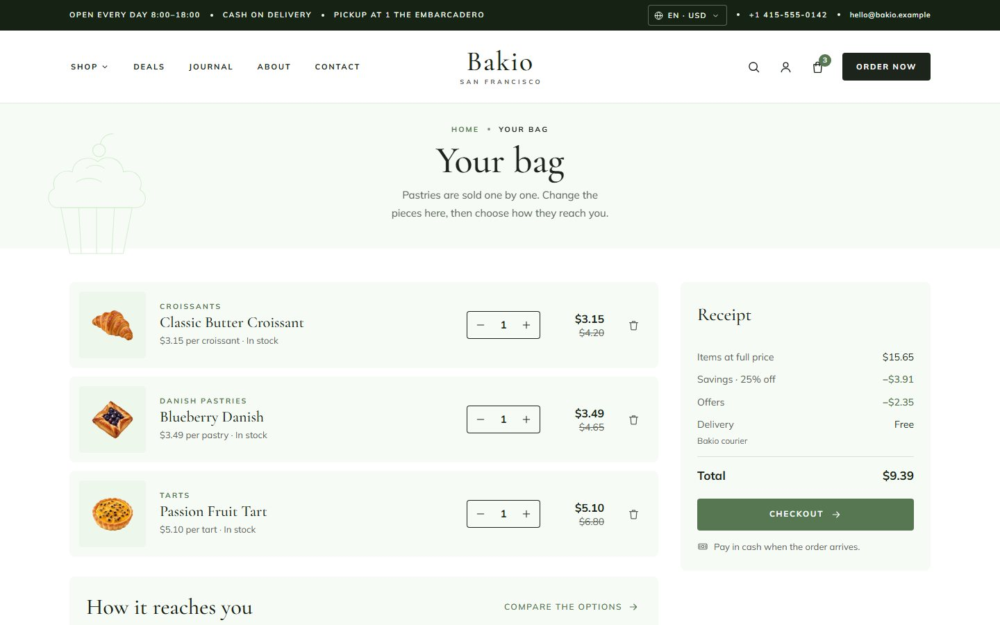
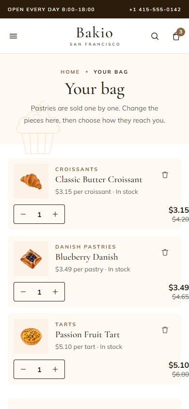
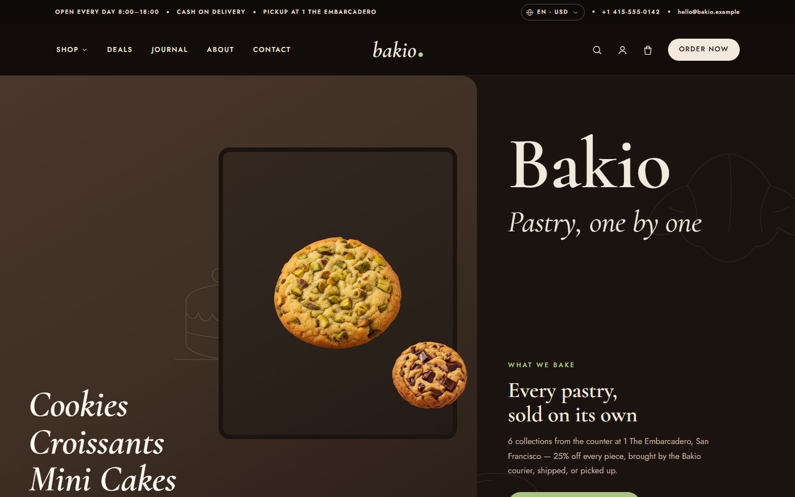
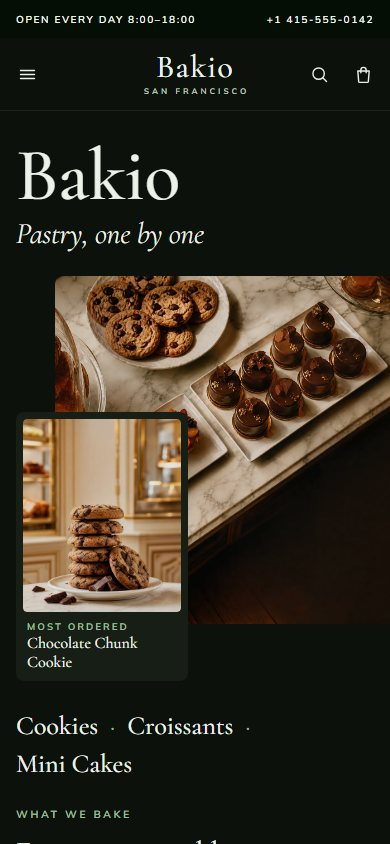

<p align="center">
  
</p>

<h1 align="center">Pralino Cocoa Patisserie</h1>

<p align="center">
  <b>A single bakery in cocoa and pistachio: a cream ground, cocoa ink, a cocoa header and footer, one pistachio accent, rounded photos and pill buttons.</b><br>
  A custom Selldone Layout built on the official <a href="https://github.com/selldone/storefront">selldone/storefront</a>.
</p>

<p align="center">
  <a href="https://pralino.selldone.shop"></a>
  <a href="https://github.com/selldone-custom-layouts/official-pralino/wiki"></a>
  <a href="https://github.com/selldone-custom-layouts/official-pralino/wiki/Install-with-AI"></a>
  
  
  
</p>

<p align="center">
  <a href="https://pralino.selldone.shop"><b>Open the live shop</b></a> ·
  <a href="https://github.com/selldone-custom-layouts/official-pralino/wiki/Install-with-AI">Set it up with AI</a> ·
  <a href="https://github.com/selldone-custom-layouts/official-pralino/wiki/Manual-Setup">Manual setup</a> ·
  <a href="https://github.com/selldone-custom-layouts/official-pralino/wiki/Shop-Requirements">What your shop needs</a> ·
  <a href="https://github.com/selldone-custom-layouts">All Selldone custom layouts</a>
</p>

---

## What it is

**Pralino Cocoa Patisserie** dresses a single pâtisserie in cocoa and pistachio, in the manner of a calm bakery website: a top bar with the counter's hours and contact, a cocoa header with the shop's name as a centred italic wordmark, a hero of the collection names over photos, counters on a scalloped cocoa band, the best-selling collections as cards, how ordering works, the ways to receive an order, a gallery of the collections, today's selection as rows, a photo band, a marquee of the collections and the journal. It was drawn for **Bakio**, a bakery that sells individual pastries for courier delivery, worldwide shipping and pickup, paid in cash on delivery.

- a cream ground (`#f7f1ea`) and cream cards with cocoa ink (`#3a2a22`); a cocoa top bar and header, a dark cocoa footer;
- **one** pistachio `#5a7440` for every action (buttons, chosen states, links); on the cocoa header and footer, its light shade;
- Cormorant for headings, numbers set large and the italic wordmark, over Jost for reading, buttons and the nav (in spaced capitals);
- rounded photos and plates, pill buttons and chips, scalloped cocoa title bands with two faint line drawings of pastries;
- flat buttons, hover changes the colour only, no line under any word or icon, selection rings inside the box;
- light by default, with a cocoa-night dark mode; a **Theme** row in the footer on the showcase shop: four palettes (Pistachio, Cherry, Caramel, Blueberry), a **Custom colour** and Light / Dark;
- it says **bag**, never cart; every word it writes is in English and Arabic (right to left).

It runs on **[pralino.selldone.shop](https://pralino.selldone.shop)**, one domain of the Selldone shop Bakio (Selldone lets each domain of a shop carry its own Layout; the shop's default and its other domains keep theirs).

Everything is read live from the shop: its title (drawn as the wordmark), collections, products, prices and savings, sales (for the hero, the collection cards and today's selection), delivery ways with their days, fees and time windows, the pickup counter and its hours, the way to pay, the articles. Nothing about Bakio is written in the code, so another bakery that imports the Layout gets its own data. Selldone's own bag, checkout, payments and orders keep working underneath.

## Screenshots

| Desktop | Phone |
| --- | --- |
|  |  |
|  |  |
|  |  |
|  |  |

| Dark mode (desktop) | Dark mode (phone) | The Theme row (footer) |
| --- | --- | --- |
|  |  |  |

## Highlights

- **Header:** a cocoa top bar that scrolls away (the counter's days and hours, the way to pay and "Pickup at <street>" on the left; the language and currency pill, the phone and the email on the right); a cocoa bar that sticks, with **Shop ⌄** (every collection with its best seller's photo and its lowest price, then the deals line), Deals, Journal, About and Contact on the left, the wordmark in the centre, search with live suggestions, the account, the bag with its count and **Order now** on the right. Shop ⌄ opens on a click and closes on a second one. On a phone: the menu button, the wordmark, search and the bag; the menu is a panel from the left with the collections, the pages, the account, a "Language & currency" row and the counter's lines.
- **Home:** the hero (the shop's name and "Pastry, one by one" beside a photo with the three most-ordered collections over it, a framed photo and the best seller as a cut-out); counters on a scalloped cocoa band (collections, the saving, the counter's days and hours, the ways to receive an order); **About** in the shop's own facts; **The collections people order most** (2 × 2 cards with an outlined numeral, the description and three best sellers); **How ordering works** (piece by piece, the courier's windows, the way to pay, pickup or shipping, and the courier's card); the courier's numbers, the offer card and **<n> ways to receive it**; a gallery of the collections around the most-ordered one; **Today's selection** (six best sellers mixed across collections, as rows with **Add to bag**); a photo band; a marquee of the collections; the journal's four newest posts last.
- **Photos:** every photo slot (the hero's two, About, How ordering works, the offer card, the photo band, the journal, the footer's texture, each collection's portrait) shows the shop's own photo when the Layout has one, else a designed fallback: a tinted surface with one of the mockup's pastry drawings, or the shop's own pastries as cut-outs. Ready-made prompts for each photo are in the design folder (no words, logos or people on any photo).
- **Collection page:** the cocoa title band with the collection's name, its line and the saving; every collection as a chip; the filter panel beside the grid; a bar with the active filters as chips and **Sort**; the grid of cards; then a strip of three panels (the courier, the collection's photo, pickup at the counter). Search, Deals and every pastry share the grid: search adds the collections it found as tabs and posts from the journal; Deals opens with the biggest saving today on a cocoa band with its round "Save".
- **Filters:** the price (two thumbs and short boxes), On offer, then every spec group of the collection's own products (a paragraph-long note is never a filter; long values four at a time with "Show N more"); a side sheet below 1200px; a change dims the cards with "Updating results…", then the new ones fade up.
- **Card:** the pastry as a cut-out on a rounded plate with a −% roundel and a quick-view eye in the plate's corners, the collection, the name, "Per <unit>" (and "only n left"), the price with the struck was-price, the saving, then **Add to bag**, which turns into "− n +" in place.
- **Product page:** the slim title band with the breadcrumb; the gallery (the pastry on its plate, thumbnails) beside a buy column that stays in view: the collection, the name, "Per <unit> · No reviews yet", the price, the saving, a deal clock only for a real end date, the stock, options only when the product has real variants, **Add to bag** beside Compare, and the delivery, pickup and payment lines. Then the tabs (Description with "Why you'll love it", Additional information, Reviews), **Buy together** (this pastry and two best sellers from other collections, "Add all three to bag"), **More <collection>**; a buy bar on a phone.
- **Bag and checkout, orders and account, pages:** the bag drawer with "Often added", the bag page with "How it reaches you", the checkout (step pills in the title band, numbered cards for contact, delivery and its windows, the address or the pickup counter, billing and a note, the receipt with "Place order"), the delivery sheet, the address sheet (map on or off), Selldone's payment window, the order page with its progress, receipt and chat, the account (Overview, Orders, Addresses, Profile), the sign-in sheet, compare, the journal and its posts, About, Terms, Privacy, FAQ, Contact and a 404 inside the Layout — all in the same cocoa-and-cream dress.
- **Footer:** a dark cocoa band with one line on how orders reach the buyer, the counter's address, days and hours, the email and the phone set large; the Theme row; a legal row with Privacy, Terms, FAQ, Selldone's cookie settings, the shop's social links and the copyright.

## Tests

Every check runs one browser at a time against the live shop, at 1440px and 390px, dark and light, a custom yellow brand colour and Arabic (right to left). Each is delivered at **TOTAL 0**.

<!-- TESTS:START -->
Live shop **pralino.selldone.shop**, version **1.0.2**, 14 November 2026 (`CIRCLE_CURRENCIES=USD,AED,DKK,SAR bash scripts/run-checks.sh https://pralino.selldone.shop <logs>`): 28 checks, each at 1440px and 390px.

| Check | What it looks for | Where | TOTAL |
| --- | --- | --- | --- |
| Ring sweep (dark, light, Arabic) | every selection ring and edge drawn inside its box | 17 pages (home, collection, deals, search, two products, compare, journal, article, About, Terms, Privacy, Contact, FAQ, 404, bag, account), 8 in Arabic | **0** |
| Card edge (kit; Pralino's cards, dark and light) | no card's content touching its edge | home, collection, search, deals, journal, About, Terms, FAQ, Contact, account | **0** |
| Corner clear | the quick-view eye on a card never on or touching words | 8 pages, 390 to 1920px | **0** |
| Circle fit (light, dark, Arabic; USD, AED, DKK, SAR; long prices) | the words in any circle stay inside it, also with a made-up "XXXX 1,234,567" in every circle | home, deals, two products | **0** |
| Contrast (dark, light, yellow brand, Arabic) | every word at 4.5:1 or better on what is really behind it | 17 pages, 8 for yellow and Arabic | **0** |
| Contrast with layers open | the bag drawer or the phone menu open; the sign-in sheet open | home, account | **0** |
| Bag audit (dark, light) | the drawer, the bag page and the address sheet | 1440 and 390 | **0** |
| Currency | every price, filter and total follows the picked currency at once | home, collection, product, deals, drawer, menus | **0** |
| Box check (dark, light, Arabic) | no photo over words, icon rows aligned | every page and open state | **0** |
| Underline (dark, light) | no line under any word or icon, at rest or on hover | 8 pages | **0** |
| Console sweep | no console or page error on any page type, opened in-app; every grouped chunk of the release evaluates | 26 pages and flows (product pages, compare, order, account, sign-in sheet, bag drawer, checkout, delivery sheet, address sheet, payment window…), light and dark, English and Arabic, 1440 and 390 | **0** |
| Checkout walk | the guest checkout from "Add to bag" to Selldone's payment window, compared with the mockups; nothing is ordered and the bag is emptied | desktop and phone | **0** |

Bakio sells in USD only, so AED, DKK and SAR stay USD on its pages; the long made-up amount stands in for them. The same suite was at 0 on 1.0.0 and 1.0.1 too. 1.0.2 put Selldone's pickup chip under the product's price and its hover card in Pralino's dress (it was a black label) and drew Selldone's cookie-settings icon in the footer's light ink. The walk on 1.0.0 led to 1.0.1: the delivery sheet drawn as the mockup's rows (each way with its days, fee line and its own windows), the fee alone on the method card, "Almost there" only after a place attempt, the checkout never wider than a phone (Selldone's coupon row), the discount code and coupons in Pralino's dress.
<!-- TESTS:END -->

## Languages

Every word Pralino writes goes through `t("key", "English")` ([`components/kalio/i18n/`](components/kalio/i18n/)): the shared words in `base/<lang>.ts`, the Layout's own in `pralino.<lang>.ts` (keys `pralino.*`), and the `bakini.*` words the shared code still uses in `bakini.<lang>.ts`. Arabic loads only when a visitor picks it and turns the whole page right to left. The wiki page [Customize](https://github.com/selldone-custom-layouts/official-pralino/wiki/Customize) has the steps for another language.

## Theme and colours

Pralino runs the shared theme switcher (`components/theme-switcher/`, the same code as the other custom Layouts). On your own shop the visitor switcher is hidden, and Pralino shows the theme you set in **one file**, [`components/pralino/pralino-theme.settings.ts`](components/pralino/pralino-theme.settings.ts): a palette (`pistachio`, `cherry`, `caramel`, `blueberry`) or any brand colour (`brandColor: "#F5C400"`; a light colour keeps dark words on it with `textOnBrand: "auto"`), `light` or `dark`, and whether your visitors get the switcher (`themeSwitcher: "showcase" | "on" | "off"`). The header and footer stay cocoa in every palette. Every colour is made readable automatically. An AI agent finds the steps in the "Theme" section of [`AGENTS.md`](AGENTS.md).

## Use it on your shop

| You want to… | Read |
| --- | --- |
| Let an AI agent (Claude Code, Codex…) set it up for your shop | [Install with AI](https://github.com/selldone-custom-layouts/official-pralino/wiki/Install-with-AI) |
| Do it yourself, step by step | [Manual Setup](https://github.com/selldone-custom-layouts/official-pralino/wiki/Manual-Setup) |
| Know what data your shop needs for the design to look right | [Shop Requirements](https://github.com/selldone-custom-layouts/official-pralino/wiki/Shop-Requirements) |
| Build, upload and verify a release | [Build and Upload](https://github.com/selldone-custom-layouts/official-pralino/wiki/Build-and-Upload) |
| Put the Layout live on your shop, or on one domain of it | [Go Live](https://github.com/selldone-custom-layouts/official-pralino/wiki/Go-Live) |
| Change the name, sections, pages, photos or languages | [Customize](https://github.com/selldone-custom-layouts/official-pralino/wiki/Customize) |
| Change the colours, dark or light, the visitor switcher | [Theme and colours](https://github.com/selldone-custom-layouts/official-pralino/wiki/Theme-and-colours) |
| Fix a blank page, a rejected upload or an old version showing | [Troubleshooting](https://github.com/selldone-custom-layouts/official-pralino/wiki/Troubleshooting) |

The wiki's source is also in [`docs/wiki/`](docs/wiki/).

## Quick start (developers)

```bash
git clone https://github.com/selldone-custom-layouts/official-pralino.git
cd official-pralino
npm run setup            # the six Selldone modules (modules/)
for p in components translate; do git -C modules/$p apply ../../patches/modules-$p.kalio.patch; done
npm install --force
npm run serve            # dev server on http://localhost:9140, reading the shop named in .env
```

`.env` names the shop the dev server reads (`VITE_APP_SAMPLE_SHOP_NAME=bakio`). Releases:

```bash
LAYOUT_ID=<your Layout id> SELLDONE_CLI_SRC=<cli clone> bash scripts/release.sh <new version> desk
```

Leave `LAYOUT_ID` out on the first upload; use the id printed after it from then on. Never reuse a version number. Keep the build under about 360 files (the release script prints the count; Pralino 1.0.1 has 273).

## Where things are

| Area | Files |
| --- | --- |
| Your theme (palette, brand colour, mode, switcher) | [`components/pralino/pralino-theme.settings.ts`](components/pralino/pralino-theme.settings.ts) |
| Pralino's tokens for both modes (`:root` light, `html.pr-dark` dark) | [`style/pralino-theme.scss`](style/pralino-theme.scss) |
| The mockup's stylesheets, scoped to `.pr` (generated by [`scripts/pralino-css.cjs`](scripts/pralino-css.cjs), never edited) | [`style/pralino/`](style/pralino/) |
| The Layout's own touches; Selldone's address sheet and payment window in Pralino's dress | [`style/pralino-layout.scss`](style/pralino-layout.scss), [`style/pralino-sd.scss`](style/pralino-sd.scss) |
| Header, bag drawer and footer | [`components/pralino/shell/`](components/pralino/shell/) (`PralinoHeader.vue`, `PralinoBagDrawer.vue`, `PralinoFooter.vue`) |
| Home | [`components/pralino/PralinoHome.vue`](components/pralino/PralinoHome.vue) |
| The wordmark, from the shop's title | [`components/pralino/PralinoLogo.vue`](components/pralino/PralinoLogo.vue) |
| Shared data and layers (the collections, the catalogue, the shop's facts, one layer at a time) | [`components/pralino/pr.ts`](components/pralino/pr.ts) |
| Shared UI (title band, card, quick view, modal, empty state, sample label, numerals, icon lines, the shop's mark) | [`components/pralino/ui/`](components/pralino/ui/) |
| Photo slots and their fallbacks | [`components/pralino/pr-photos.ts`](components/pralino/pr-photos.ts), `PrPhoto.vue`, `PrCuts.vue` |
| The shop's photos (optional; the slots fall back to drawings and cut-outs) | `assets/pralino/<slot>.webp` and `assets/pralino/hero-<collection>.webp`, names in `pr-photos.ts` |
| Collections, search, deals, every pastry (filters and sort) | [`components/pralino/shop/PrListing.vue`](components/pralino/shop/PrListing.vue), [`pages/products/`](pages/products/) |
| Product page and compare | [`components/pralino/product/`](components/pralino/product/), [`pages/product/`](pages/product/), [`components/pralino/compare/`](components/pralino/compare/) |
| Bag and checkout, the delivery sheet | [`pages/basket/cart/`](pages/basket/cart/) with [`components/pralino/buy/pr-cart.ts`](components/pralino/buy/pr-cart.ts); the delivery sheet in [`pages/basket/cart/SCartShippingOptions.vue`](pages/basket/cart/SCartShippingOptions.vue) |
| Order page | [`components/pralino/order/`](components/pralino/order/), [`pages/basket/order/`](pages/basket/order/) |
| Account and sign-in | [`components/kalio/account/`](components/kalio/account/), [`pages/user/`](pages/user/), [`components/kalio/shell/KalioSignIn.vue`](components/kalio/shell/KalioSignIn.vue) |
| Journal, article, About, Terms, Privacy, FAQ, Contact, 404 | [`components/pralino/read/`](components/pralino/read/), [`pages/blog/`](pages/blog/), [`pages/official/`](pages/official/), [`pages/faq/`](pages/faq/), [`pages/errors/404/`](pages/errors/404/) |
| Words (English and Arabic) | [`components/kalio/i18n/pralino.en.ts`](components/kalio/i18n/pralino.en.ts), [`pralino.ar.ts`](components/kalio/i18n/pralino.ar.ts) (`pralino.*`; `bakini.*` for the shared code) |
| How the mockup became the Layout, reversible choices, data rules and releases | [`PRALINO.md`](PRALINO.md) |
| The checks | [`scripts/run-checks.sh`](scripts/run-checks.sh) and the tools it names (`CIRCLE_CURRENCIES` for the circle checks) |
| Release tooling | [`scripts/`](scripts/) |
| Selldone storefront's original README | [`README.selldone.md`](README.selldone.md) |

Pralino started from [Bakini Noir](https://github.com/selldone-custom-layouts/official-bakini) and keeps its buy flow underneath (the Kalio base: Selldone's bag, checkout, address sheet, payment window, order, account, sign-in and compare logic; the theme and region switchers; the release scripts and the checks); every page's markup is Pralino's own.

## Credits and license

Built on the official [Selldone Storefront](https://github.com/selldone/storefront) (MIT License, © Selldone); see [`LICENSE.md`](LICENSE.md). Part of **[Selldone Custom Layouts](https://github.com/selldone-custom-layouts)**.
